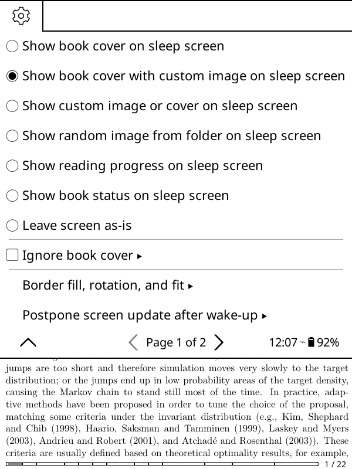

# Cover with custom image

A KOReader plugin that shows the cover of the book you are reading on the
sleep screen, with an image of your own drawn on top of it -- a frame, a
badge, a "this device belongs to" note, whatever you like. It is the stock
"Show book cover" and "Show custom image" wallpapers, together.

## Using it

**Settings → Screen → Sleep screen → Wallpaper → Show book cover with custom
image on sleep screen.** The first time, it asks you to pick the image; you
can change it later under **Custom images → Choose overlay image**.

Use a PNG with transparency: anything opaque in it hides the cover
underneath. The image is fitted to the screen exactly as the "Show custom
image" wallpaper fits it, not to the cover, so a PNG made at your screen's
resolution lines up pixel for pixel whatever the shape of the cover.

Everything else behaves as it does for "Show book cover":

* **Ignore book cover**, and **Do not show this book cover on sleep screen**,
  still apply. When the cover is not shown, you get the random image instead,
  without the overlay, just as you would without the plugin.
* **Border fill, rotation, and fit** applies to both the cover and the
  overlay, each in the way it would on its own.
* The **sleep screen message**, if you have one, is drawn above both.

## Installing

Download the zip from the [latest
release](https://github.com/bitesized/covercustompng.koplugin/releases/latest)
and unpack it into KOReader's `plugins/` folder (on a Kobo,
`.adds/koreader/plugins/`), then restart KOReader.

The directory **must** be named `covercustompng.koplugin`: KOReader only
looks at directories whose name ends in `.koplugin`, and silently ignores
everything else. The release zip already has the name right. GitHub's own
"Download ZIP" button does not -- it gives you `covercustompng.koplugin-main`,
which KOReader will not load until you rename it.

## How it works

The mode is saved as the stock `cover` wallpaper plus a setting of the
plugin's own (`covercustompng_enabled`, with the image in
`covercustompng_file`). All the cover logic -- exclusions, fallbacks, fill,
stretch and rotation -- is therefore KOReader's, and disabling the plugin
leaves you with the plain book cover.

The overlay goes in by wrapping `Screensaver:setup` and `Screensaver:show`.
`show` builds the cover with a single `ImageWidget:new` call; for the
duration of `show`, the plugin intercepts that call and returns the cover and
the overlay stacked in an `OverlapGroup`, which is why the sleep screen
message still ends up on top.

The menu entries are added to the stock Wallpaper menu from `addToMainMenu`,
which KOReader calls just after it has built that menu, matching the entries
by their (translated) text.

None of this is a published plugin API, so an upstream change to
`ui/screensaver.lua` or the sleep screen menu could break it.
